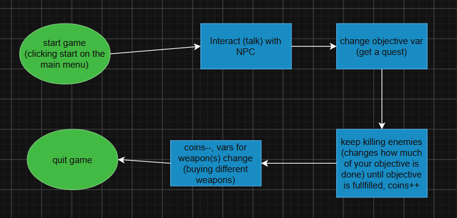

# CS193 Final

Short RPG game

## The Problem

In the summer, I teach game development to K-8 using Godot. While I have made example games, they've typically been rushed and done during my planning period, and not fully fleshed-out games showing the students how far they truly could go. I would like a short, but higher quality game to show them as an example!

## How It Works

Small RPG game with interactable NPCs, quests, enemies to kill, coins to collect, and shops to spend your money at

## Tech Stack

- **Language:** GDScript
- **External tools:** Godot

## Setup

[Download Godot][https://godotengine.org/] and open up the cloned repo to import into Godot, click the run button

## Usage

Click the run button (top right)
WASD to move

## Roadmap

- [ ] Dynamic Enemies
- [ ] More items in shop besides weapons
- [ ] More unique quests
- [ ] Puzzles

## Author

[Cal Vest][https://github.com/c4calcium]
